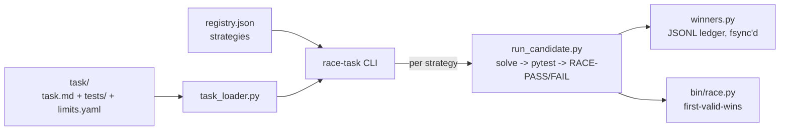

<div align="right">

[](LICENSE)
[](https://github.com/toxicwind/agon)
[](https://www.rust-lang.org)
[](https://python.org)

</div>

# ⚔️ agon (αγών)

**The empirical code contest.** Race candidate code strategies against each
other on the same task and let **real acceptance tests** decide the winner —
not vibes, not author confidence. First *passing* solution wins; slow is a kind
of wrong, broken is disqualified.

## Why you should care

Every codebase has a slow strategy someone "felt was right." Agon makes strategy
selection empirical: register N solvers, run them on real pytest acceptance
tests in isolated testbeds, and the first passing solution wins. E2E real — no
mocks, no unit-test theater.

## Features

- **First-passing-wins** — validity = exit `0` **and** the acceptance tests pass; a broken solution never wins, no matter how fast.
- **Per-hop latency** — solve_s, test_s, total_s, wall_s measured everywhere; the winner ledger is fsync'd.
- **Pluggable strategies** — append to `strategies/registry.json`; your solver writes `<outdir>/solution.py`.
- **Frozen contract** — `INTERFACE.md` is the harness↔adapter interface, versioned and stable.
- **Audit trail** — per-race `runs/` JSON, fsync'd JSONL winners ledger, plus the global HFT winner log (`~/.cache/shingle/hft_race_winners.jsonl`).
- **HFT racer inside** — asyncio, event-driven, first-valid-wins, SIGKILLs the loser process group immediately.

## How it works



## Quick start

```bash
cd agon
./race-task tasks/smoke-two-sum --strategies all
./race-task tasks/smoke-two-sum --strategies demo-fast,demo-slow --timeout 30
```

Expected: `demo-fast` wins (~1s), `demo-slow` valid but slower, `demo-broken`
invalid — the winner is always a *passing* solution.

## Architecture

```
agon/
├── race-task            # CLI: race-task <task> --strategies all|a,b --timeout N
├── task_loader.py       # task-spec loader (task.md + tests/ + limits.yaml)
├── registry.py          # candidate registry (strategies/registry.json)
├── run_candidate.py     # one contestant: solve -> pytest -> RACE-PASS/RACE-FAIL
├── winners.py           # JSONL winners ledger (fsync'd)
├── bin/race.py          # the HFT racer (first-valid-wins, fail-fast, asyncio)
├── bin/measure.py       # latency measurement helpers
├── strategies/          # registered strategies + registry.json
├── tasks/               # tasks with real pytest acceptance tests
├── winners/             # per-task JSONL ledgers
└── runs/                # generated strategies.json per race (audit trail)
```

## Add a strategy

Append to `strategies/registry.json` — your solver writes `<outdir>/solution.py`:

```json
{"name": "my-solver",
 "cmd": ["python3", "/abs/path/my_solver.py", "{outdir}"]}
```

## Add a task

```
tasks/<name>/task.md      # problem statement
tasks/<name>/tests/       # pytest; `import solution` must work
tasks/<name>/limits.yaml  # solve_timeout_s / test_timeout_s / workers
```

## Design

- **No mocks.** Strategies are real subprocesses; acceptance tests are real
  pytest runs in isolated sandbox dirs.
- **Validity = exit 0 + `RACE-PASS` on stdout**; `run_candidate` only emits it
  when pytest passes on the produced solution.
- **Contest-first.** The harness is a contest, not a pipeline: losers are
  SIGKILLed the moment a winner appears — a slow correct answer is wrong.

## License & security

MIT — strategies are arbitrary code run as subprocesses, so the harness trusts
the registry: only register solvers you (or the fleet) wrote. Testbeds are
isolated per run; don't run untrusted solvers on a box you can't rebuild.